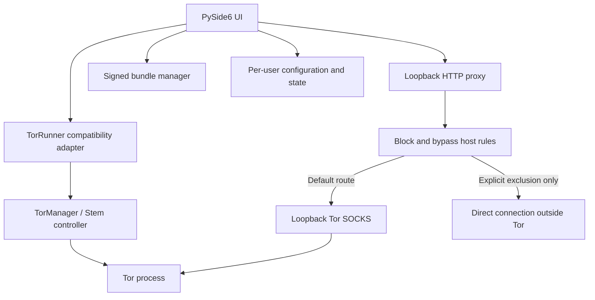

# TorProxy

TorProxy is a PySide6 desktop front-end for running a locally managed Tor process and exposing a loopback-only HTTP proxy to applications that support manual proxy configuration.

The project is being modernized from a flat desktop utility into a testable Python core with safer Tor lifecycle management, validated host policy, configurable bundle signature verification, and reversible system-proxy integration.

> **Privacy and security note:** TorProxy is not a guarantee of anonymity. It protects only traffic that is actually routed through its Tor-backed proxy. Applications can make direct connections, leak information at the application layer, or retain identifying state. Read [the security model](docs/SECURITY.md) before relying on it.

## Features

- Start/stop supervision for an application-owned Tor process, with bounded startup and shutdown.
- Loopback-only SOCKS, ControlPort, DNSPort (when configured), and HTTP proxy listeners.
- Stem-based Tor control with cookie authentication, bootstrap status, process-identity checks, and rate-limited `NEWNYM` requests.
- HTTP forwarding and HTTPS `CONNECT` tunnels through Tor's SOCKS endpoint, with remote DNS for Tor-routed destinations.
- Immutable block/bypass host-rule snapshots shared by HTTP and CONNECT.
- An IP-check action that uses the configured local HTTP proxy and **does not retry directly**.
- Explicit opt-in for system proxy changes, snapshot-based restoration, and protection against overwriting later external changes.
- Home-page **Open Browser** launcher for detected Chromium and Firefox-family browsers, using isolated per-browser profiles and the existing TorProxy HTTP proxy.
- Listener ports are allocated once, persisted in the per-user configuration, and reused on later launches; automatic ports are repaired only when a conflict is detected.
- System-wide Tor tunnel on Windows x64 and glibc-based Linux x86_64, managed from **Updates → Tunnel**. It downloads a selected, SHA-256-pinned sing-box release and uses a dedicated TUN interface rather than changing each application's proxy settings.
- Tor Expert Bundle downloads use Tor's live SOCKS5H route whenever Tor is READY, are restricted to official distribution hosts, and are safely extracted. OpenPGP publisher-signature verification is optional and disabled by default; it can be enabled to check the pinned Tor signing-key fingerprint.
- Versioned configuration, per-user writable data paths, atomic settings writes, tests, and CI.

## Architecture



The new, independently testable code lives in `src/torproxy/`. Existing UI modules continue to use a small compatibility layer while migration progresses. See [Architecture](docs/ARCHITECTURE.md) for lifecycle and thread boundaries.

## Requirements and support status

| Area | Current policy |
|---|---|
| Python | `>=3.10`, as declared in `pyproject.toml` |
| Desktop UI | PySide6 |
| Bundle downloader | Windows/Linux, x86_64 or 32-bit x86 Expert Bundles |
| System proxy integration | Windows user Internet Settings; GNOME `gsettings` on Linux |
| macOS | Not currently supported by the bundle downloader or system-proxy adapter |
| CPU/OS validation | GitHub Actions is configured for Windows and Ubuntu on Python 3.10–3.13; check the [Actions page](https://github.com/nima-salamat/tor-proxy/actions) for actual results |

The matrix describes intended CI coverage, not a claim that every platform has been manually tested. Arbitrary user-supplied Tor executables may work, but are not part of the bundle downloader's supported matrix.

## Prebuilt Windows and Linux builds

Portable builds are published on the [GitHub Releases page](https://github.com/nima-salamat/tor-proxy/releases). They include the Python runtime and application dependencies, so a separate Python installation is not needed.

- **Windows x64, without Tor:** `TorProxy-windows-x64.zip`. Extract the complete `TorProxy` folder and launch `TorProxyLauncher.exe`; keep `_internal` beside the launcher and `TorProxy.exe`. The Windows launcher uses a lightweight native splash (no extra Qt runtime), embeds the TorProxy icon and Windows product identity, and reports startup progress from Python. Run `powershell -ExecutionPolicy Bypass -File .\Create-TorProxyShortcut.ps1` to create a Start menu shortcut named **TorProxy**; add `-Desktop` to create a desktop shortcut instead, then pin that shortcut to the taskbar.
- **Windows x64, with Tor:** `TorProxy-windows-x64-with-tor-bundle.zip`. Includes one current, signature-verified Tor Expert Bundle and selects it automatically on a fresh install.
- **Linux x86_64, without Tor:** `TorProxy-linux-x64.tar.gz`. Extract it and run `./TorProxy/TorProxyLauncher`; the archive preserves executable permissions.
- **Linux x86_64, with Tor:** `TorProxy-linux-x64-with-tor-bundle.tar.gz`. Includes one current, signature-verified Tor Expert Bundle and selects it automatically on a fresh install.
- Linux builds are produced on Ubuntu 22.04 and target Ubuntu 22.04 or compatible newer glibc-based distributions; other distributions may need system Qt display/runtime libraries.
- On minimal Linux installations, Qt may need system graphics/display libraries. The bundled Linux Tor executable also requires the system `libevent-2.1.so.7` runtime. On Ubuntu 22.04, install these with `sudo apt-get install libegl1 libgl1 libxcb-cursor0 libxkbcommon-x11-0 libevent-2.1-7`.
- Packages use PyInstaller's **one-directory** layout: the downloadable archive is compressed, but startup avoids one-file extraction to a temporary directory. The build uses OpenCV's headless wheel to avoid shipping an unnecessary second Qt GUI stack.
- The `without-tor-bundle` packages keep the original smaller, on-demand download behavior. The `with-tor-bundle` packages contain exactly one bundle selected from the official Tor distribution listing: stable releases are preferred, then supported alpha releases, and only the newest release with an exact OS/CPU Expert Bundle plus detached signature is downloaded. The build verifies the detached signature against TorProxy's pinned Tor signing-key fingerprint before packaging; missing bundles or failed verification stop the build. The archive, signature sidecar and verification marker are retained so the application can re-check the bundle before selecting it.
- GnuPG is only needed when the optional OpenPGP publisher-signature check is enabled in Settings → Advanced. The ZBar decoder is optional because the built-in OpenCV QR decoder remains available.
- Windows binaries are not Authenticode-signed by this workflow, so Windows SmartScreen may show an unrecognized-app warning.

Pushing a version tag such as `v2.0.1` builds four portable packages (Windows/Linux, each with and without Tor) and publishes them with `SHA256SUMS.txt`. The release build discovers the current stable-first Tor version separately on each runner, chooses the first release that has that runner's exact x86_64 Expert Bundle and detached signature, and downloads only that one archive. Running **Build and release → Run workflow** from Actions builds and smoke-tests all package variants as workflow artifacts, without publishing a release.

## Install and run

### Native startup launcher

The portable Windows and Linux packages start through a small C++17/Qt 6 launcher. It displays an animated, frameless splash before starting the existing PyInstaller application, then waits for an authenticated local IPC message from Python after the main window has been shown and its first paint events have been processed. The launcher exits after that acknowledgement; the original `TorProxy.exe` / `TorProxy` process continues independently.

The launcher does not replace or rename the main application executable. Running `TorProxy.exe` (Windows) or `TorProxy` (Linux) directly remains supported and bypasses the splash. Startup failures are shown in the splash with actions to retry, open the per-user startup log, or close. The IPC channel uses a per-launch random local socket name and token; no TCP port is opened.

The launcher uses a separate Qt 6.8.3 runtime deployed beside the application. Its Qt license notices are included in `launcher-licenses/`. Linux packages still require the normal system graphics libraries documented above; the launcher ships its Qt libraries and platform plugins.

### Prerequisites

Install Python 3.10 or newer. GnuPG (`gpg`) is needed only when optional OpenPGP signature verification is enabled in Settings → Advanced. On Debian/Ubuntu, the optional QR-code feature needs native ZBar:

```bash
sudo apt-get update
sudo apt-get install -y gnupg libzbar0
```

On Windows, install GnuPG from a trusted distribution and ensure `gpg.exe` is on `PATH`, or configure `TORPROXY_GPG_EXECUTABLE` with its full path. Some platforms require additional native setup for QR decoding; see [Troubleshooting](docs/TROUBLESHOOTING.md).

### Development installation

```bash
git clone https://github.com/nima-salamat/tor-proxy.git
cd tor-proxy
python -m venv .venv
```

Activate the virtual environment, then run:

```bash
python -m pip install --upgrade pip
python -m pip install -e ".[dev]"
python main.py
```

A legacy-compatible runtime dependency file is also provided:

```bash
python -m pip install -r requirements.txt
```

The first launch migrates an existing root-level `config.json` into the per-user configuration directory when possible. Invalid configuration is reported rather than silently treated as a successful load.

## Get a Tor bundle

1. Open the application's Tor bundle/update view.
2. Retrieve the official release list.
3. Select a release for the current supported OS/CPU.
4. Confirm download and watch the status until safe extraction finishes; the optional OpenPGP check must pass when enabled.
5. Review the bundle's trust label, then select it as the default Tor executable. The bundle page also offers **Import .tar.gz** for a locally saved Expert Bundle. Select the exact current-platform archive; a matching `.asc` beside it is verified when OpenPGP is enabled.

Downloads and imported archives are stored in the current user's application-data directory, not inside the installed source tree. Unsafe archive entries and path traversal are always rejected. OpenPGP verification is off by default. When explicitly enabled, invalid/missing signatures or an unavailable GnuPG runtime stop signed installation. A manually imported archive without a verified signature is explicitly marked `LOCAL · UNSIGNED` and requires confirmation before it can be selected as the default.

Older repository versions included large archives in `bundles/`. These are no longer required in source control. Existing local archives that lack a verifiable `.asc` signature are not automatically trusted by the updater; download a verified bundle again, or explicitly select a local Tor executable whose origin you trust.

## Release channels and bundle verification

The updater recognizes numeric stable releases with either two or three components (for example, `16.0` and `15.0.26`) and the supported alpha naming convention (for example, `16.0a14`). Stable releases are prioritized ahead of alpha prereleases; versions within each channel are sorted numerically. The release builder uses this same order and skips a release only when its exact platform/architecture Expert Bundle and required signature are not listed. A release directory is downloadable only when the exact current-platform Expert Bundle is listed; its matching detached `.asc` signature must also be listed when OpenPGP verification is enabled. Tor Browser installers, `.mar` updates, debug archives and checksum files are not substitutes for an Expert Bundle.

The bundle page displays transfer bytes and, when the server advertises a usable `Content-Length`, percentage, speed and an approximate remaining-time estimate. Unknown transfer lengths use an indeterminate progress bar. When enabled, signature verification appears as a distinct stage; safe archive extraction and installation are always shown separately. A completed transfer alone never counts as an installed bundle. Cancellation is available during network transfer and is disabled during stages that cannot be safely interrupted.

OpenPGP verification is disabled by default and can be enabled in Settings → Advanced. When enabled, the detached signature is checked against the independently pinned Tor signing-key fingerprint and GnuPG is discovered from `PATH`, common installation paths, or `TORPROXY_GPG_EXECUTABLE`. If no verifier can be started, the signed installation stops. When OpenPGP is disabled, TorProxy labels the installation `HTTPS ONLY · UNSIGNED` and does not claim publisher authentication; choose that mode only if you accept the reduced security guarantee.

## Start Tor and configure an application

1. Start TorProxy and select **Connect**.
2. Wait for bootstrap to reach 100%. The application checks the managed Tor ControlPort and SOCKS listener separately from the local HTTP proxy.
3. Use the HTTP proxy endpoint displayed by TorProxy. It listens on `127.0.0.1`; configure both HTTP and HTTPS proxy fields in your application to `127.0.0.1:<shown-proxy-port>`.

To diagnose a stalled connection, open **Event Log → Live Tor log**. It streams the active `tor.log` from disk, uses severity colors, limits the number of rendered lines, and loads earlier entries in pages. The percentage can be populated from Tor's own bootstrap notices before the ControlPort status becomes available; TorProxy does not mark the connection as ready until the ControlPort identity and SOCKS listener checks pass.
4. Test with **What is my IP?**. It sends an HTTPS request through the local proxy and reports the observed exit IP only if the proxied request succeeds.

Do not expose the local HTTP proxy, SOCKS port, or ControlPort to a LAN. The application deliberately rejects non-loopback HTTP proxy binds.

## Open Browser

When Tor is fully READY, choose **Home → Open Browser** to launch an installed browser through the existing loopback HTTP proxy. TorProxy currently discovers common Chromium-family browsers (Chrome, Chromium, Edge, Brave, Vivaldi, Opera, Opera GX, Yandex and Ungoogled Chromium) and Firefox-family browsers (Firefox, Firefox ESR, LibreWolf, Waterfox, Floorp and Zen Browser) on Windows and Linux. Windows discovery combines the `Clients\StartMenuInternet` browser registrations, Start Menu `.lnk` shortcuts, `App Paths`, uninstall metadata and per-user/per-machine installation locations; Linux discovery reads XDG `.desktop` launchers (including their `Name`, `Exec`, `TryExec` and `Icon` fields), Flatpak/Snap exports and `PATH`. Browser cards use the installed executable/shortcut icon on Windows and the desktop-theme icon on Linux, with a browser-specific fallback. **Add custom browser** stores an additional executable in the user's configuration directory.

Each browser receives its own TorProxy profile under the per-user application-data directory. Chromium launches with a single `--proxy-server=http://127.0.0.1:<port>` and a separate `--user-data-dir`; Firefox receives managed HTTP/HTTPS proxy preferences in its dedicated `user.js` and starts with `--profile`. Firefox's profile-scoped remoting reuses an already-running TorProxy Firefox profile on repeated launches; a changed proxy port gets a different profile directory. The user's normal browser profile and system-wide proxy settings are not modified. TorProxy does not add an explicit `direct://` route to Chromium's proxy argument. Firefox's isolated profile disables its proxy-failure direct failover preference for system requests. These are browser-level controls, not an OS firewall. The system tunnel is managed separately in Updates → Tunnel and does not provide operating-system firewall enforcement.

Tor Browser is intentionally excluded from this generic launcher because it manages its own Tor process and browser profile; it should be launched separately. The last known inventory is cached in a small SQLite database under the per-user application data directory (`browser_inventory.sqlite3`). Opening the dialog reads that local snapshot immediately and schedules a fresh OS scan on Qt's global `QThreadPool`; while the scan spinner is visible, cached entries remain usable. When discovery finishes, one SQLite transaction replaces the snapshot so uninstalled browsers disappear from both the cache and the UI. Before launching a cached entry, TorProxy checks its executable again; a missing or moved executable is removed immediately and reported without waiting for discovery. The Refresh control starts another background scan.

The launcher is enabled only after Tor bootstrap, ControlPort verification and the local HTTP proxy are ready. It checks that the loopback HTTP listener responds before starting a browser. Browser profiles are separate from the browser's everyday profile, so bookmarks, extensions and sign-in state are not automatically shared.

**Privacy limitation:** a regular browser launched through TorProxy is not Tor Browser. Browser fingerprinting, application metadata and browser-specific bypasses remain relevant. TorProxy applies browser-specific restrictions to WebRTC's non-proxied UDP paths, which may reduce call/media compatibility, but these settings are not a complete traffic firewall. This feature does not promise anonymity; do not treat it as equivalent to Tor Browser.


## Identity requests

Choose **Change Identity** to request Tor's `NEWNYM` signal. The application consults Stem's cooldown information and does not start a repeating timer by default.

A successful `NEWNYM` command means Tor accepted an identity/circuit request; it does **not** guarantee a different public IP. Existing TCP connections can continue using their existing circuits. See [Stem's controller API](https://tpo.pages.torproject.net/network-health/stem/api/control.html) for details.

## Bridges and advanced settings

Bridge mode accepts complete Tor bridge records with an IPv4 or bracketed IPv6 endpoint. Records may include a supported transport (**obfs4**, **Snowflake**, **WebTunnel**, or **meek_lite**) or be plain endpoint/fingerprint entries where no pluggable transport is used. TorProxy normalizes copied text to one canonical record per line, separates adjacent records pasted on a single line (including plain `Bridge [IPv6]:port` records), removes the optional torrc `Bridge` prefix, and strips accidental quotes around IPv6 authorities. The Settings page shows saved entries as individual cards with copy and remove actions. Manual input, QR imports, and startup configuration use the same parser. Unrecognized or incomplete records do not overwrite the previous valid list.

In **Settings → Bridges**, each bridge card also shows live usage from Tor's authenticated ControlPort. It is marked connected only when a currently built circuit's first hop matches that bridge's identity fingerprint. A bridge can remain configured yet not be observed in a current circuit; this is not by itself proof that the bridge is dead.

The **WebTunnel SNI imitation** option is off by default, which leaves the hostname from each bridge's `url=` parameter unchanged. You can select one of the suggestions or type a custom DNS hostname; TorProxy then adds `sni-imitation=<hostname>` to WebTunnel records only. This setting applies on the next Tor start, does not replace `url=`, and is dependent on a Lyrebird build and bridge that support SNI imitation. Not every bridge supports this option, so restore the default if it prevents bootstrap.

In **Settings → Bridges**, you can optionally enable automatic bridge cleanup. Before connecting, TorProxy tests each configured bridge in an isolated Tor process (up to four checks in parallel). A failed record is removed from the saved list only when at least one other bridge is confirmed to complete bootstrap. Explicit dial failures can be removed; ambiguous results and local Lyrebird/TLS/runtime errors are retained. If no bridge succeeds, the entire original list is preserved and the normal Tor startup path still gets a chance to try the configured alternatives. If the real Tor bootstrap later times out, TorProxy performs one fresh check and retries once only when a working alternative is confirmed and cleanup actually reduces the list. Generic `general SOCKS server failure` messages, SOCKS DNS-leak warnings, and missing-hop/directory notices are not treated as proof that a configured bridge is dead. This preflight can add up to about 30 seconds per bridge-check wave; bridge addresses are not written to the event log.

The supervised Tor configuration currently supports circuit dirtiness, new-circuit period, IPv4/IPv6 client behavior, bridge records, and local listener endpoints. Country-specific `ExitNodes`/`StrictNodes` controls are not presented as supported UI features in this redesign. Avoid unreviewed Tor directives.

## Blocked hosts and exclusions

Blocked-host and excluded-host lists share the same validated hostname-rule engine. They apply to requests through the loopback HTTP proxy (HTTP and HTTPS `CONNECT`) and to supported TCP connections through System Tunnel. The HTTP proxy uses saved rules immediately; System Tunnel reads the same files when it starts, so stop and start the tunnel after changing a rule. Hostname rules in TUN are matched using FakeIP reverse mapping or HTTP/TLS hostname sniffing; IP-literal rules match destination IPs. Supported examples:

- `example.org` matches the hostname and all subdomains.
- `=example.org` matches only that exact hostname.
- `*.example.org` matches subdomains at any depth, but not `example.org` itself. For example, `*.ir` matches `example.ir` and `api.example.ir`.
- `*-api.something.com` matches a single DNS label such as `v2-api.something.com`; `api-*.something.com` and `api.*.something.com` are supported too.
- `*example.org` remains a backward-compatible shorthand for `*.example.org`.

A `*` wildcard inside a label matches zero or more characters but never crosses a dot. Label-glob patterns match the same number of hostname labels; the special `*.domain` form matches subdomains across any depth. This is **glob syntax, not regex syntax**. Arbitrary regular expressions, `?`, and character classes are not accepted. Hostnames are case-insensitive and Unicode labels are normalized using IDNA. Wildcards embedded within an internationalized label must use its ASCII/IDNA form.

Excluded hosts intentionally connect directly rather than through Tor in HTTP-proxy mode. In System Tunnel, matching TCP connections use sing-box's direct outbound; DNS for TUN clients remains handled by the configured FakeIP/Tor-routed resolver. Direct destination connections can expose the origin IP and destination metadata to the local network or ISP. Leave exclusions empty unless that bypass is intentional. Block rules take precedence over exclusions. System Tunnel is TCP-only; unsupported UDP is rejected.

## System proxy settings

System proxy changes are **manual and disabled by default**. Tor startup never changes global settings automatically.

The system-proxy control currently supports Windows Internet Settings and GNOME `gsettings`. Before changing settings, TorProxy saves the previous values. On clear/shutdown, it restores them only when it can confirm the settings still match the values it applied. If another application changed them in the meantime, TorProxy leaves those external changes untouched and reports that manual inspection may be required. macOS integration is not implemented.

Applications configured manually to use `127.0.0.1:<shown-proxy-port>` do not require system-wide proxy changes.

## System-wide Tor tunnel

Manage the system-wide Tor tunnel from **Updates → Tunnel**. The page lists stable sing-box versions whose official Windows/Linux archives have been pinned and SHA-256 verified by this TorProxy build. Choose a version, install it, and use the same page to start or stop system routing. Windows requests Administrator approval for TUN routing; Linux uses PolicyKit (pkexec).

The page can check GitHub for the latest stable sing-box release. A newer upstream release is shown in the version list as **not verified** when this TorProxy build does not yet have a reviewed platform digest; it stays disabled until a later TorProxy update pins it. This avoids executing a release that has not been integrity-pinned. The Tunnel manager uses the same compact cards, typography, release list, button hierarchy, colors and progress treatment as the Tor Bundle updater. Its status refreshes while open, so Start is enabled only after Tor reaches verified READY and returns to Waiting for Tor when Tor disconnects.

Tunnel-engine downloads and release checks use Tor's loopback SOCKS5H route when Tor is READY. When Tor is stopped, TorProxy asks for explicit permission before making that individual request directly. A failed Tor-routed request never falls back automatically to a direct connection.

The TUN routes supported system TCP connections explicitly through Tor's local SOCKS listener. Client DNS is hijacked into a local FakeIP pool; reverse mapping restores the original hostname for SOCKS5 so Tor resolves it at the exit. The HTTPS DNS server is retained as sing-box's explicit default domain resolver for internal dial-time lookups and is reached through Tor SOCKS. Tor and sing-box executable paths bypass the TUN to prevent a routing loop. Unmatched traffic is blocked. This feature is independent of the retired Kill Switch and does not install or require a system-wide firewall policy.

**This is a TCP-only tunnel, not a general-purpose UDP VPN.** Tor's SOCKS interface cannot carry arbitrary UDP: unsupported UDP traffic is rejected rather than routed directly. Apps that require UDP/QUIC, real-time media, games, or other unsupported protocols may fail. Strict routing can also affect virtual machines, containers, local-network discovery, or LAN access. The feature supports Windows x64 and glibc-based Linux x86_64; macOS, Android, ARM, and musl-based Linux are not supported.

Before a new Tor connection, TorProxy checks for a previous sing-box process-state record and reconciles it through the privileged helper. It stops a process only when its saved PID, executable path, start time and config identity still match; an unreadable stale record is removed only when the TUN interface is absent. Settings → Advanced also provides an explicit emergency inspection/cleanup action for the same managed state. An orphaned adapter or a live PID with a mismatched identity is deliberately not removed: the app cannot prove that such routes belong to this sing-box session. In that case Connect is blocked and the exact state must be inspected manually. Stop the system tunnel before disconnecting Tor or exiting TorProxy. If the process identity cannot be verified or the TUN interface cannot be removed, TorProxy keeps Tor running and blocks application exit rather than claiming routes were safely restored.

## Configuration and data paths

Settings, application state, logs, and downloaded bundles live in per-user locations rather than the source checkout. Defaults and supported legacy keys are described in [Configuration](docs/CONFIGURATION.md).

Traffic usage counts bytes observed in both directions for proxied HTTP requests and CONNECT tunnels. It is an application-level counter, not a total network-usage meter; under extreme bursts, the bounded counter queue can drop updates and log a warning.

## Security and limitations

- The default HTTP proxy, SOCKS, ControlPort, and DNS listeners bind to loopback.
- The ControlPort is cookie-authenticated; the controller must identify the Tor process launched by this application.
- The IP checker has no direct-network fallback.
- When OpenPGP verification is explicitly enabled, downloads fail closed when a signature or pinned-key check fails; safe extraction checks always apply in either mode.
- Logs avoid recording request URLs and query strings, but local logs and host-rule lists should still be treated as user data.
- Direct exclusions intentionally bypass Tor.
- System-proxy restoration can fail safely if another program changes settings.
- The loopback HTTP proxy and system tunnel are not an operating-system firewall. Applications can ignore a per-app proxy or use network paths that do not traverse the TUN. The system tunnel routes supported TCP traffic through Tor and rejects unsupported UDP while it is active.
- CI tests use fakes/local servers; they do not prove real-world anonymity or verify every OS integration.

Read [Security](docs/SECURITY.md) and [Troubleshooting](docs/TROUBLESHOOTING.md) before reporting an issue.

## Development and testing

```bash
python -m pip install -e ".[dev]"
ruff check src/torproxy tests --select E,F,UP --ignore E501
pytest --cov=torproxy.host_rules --cov=torproxy.ip_check --cov-report=term-missing --cov-fail-under=75
```

The offline suite also exercises stable/alpha release parsing, exact artifact/signature selection, transfer progress/cancellation, GnuPG failure modes, optional HTTPS-only installation, trust-method markers, and atomic installation publication. Normal CI does not download a real Tor archive.

An opt-in integration test contacts the official Tor Project distribution, downloads a compatible Expert Bundle, and verifies its real detached signature. It requires GnuPG, internet access, and a supported OS/architecture. Do not enable it in an untrusted test environment because it downloads a large archive.

On Linux/macOS shells with a supported runtime:

```bash
TORPROXY_ONLINE_SIGNATURE_TEST=1 pytest -m integration tests/test_updater_pipeline.py::test_live_official_expert_bundle_download_and_signature
```

In Windows PowerShell:

```powershell
$env:TORPROXY_ONLINE_SIGNATURE_TEST = "1"
pytest -m integration tests/test_updater_pipeline.py::test_live_official_expert_bundle_download_and_signature
```

A skipped opt-in test is not evidence of a verified download. Record the actual test result and platform when reporting integration validation.

See [Contributing](CONTRIBUTING.md), [Changelog](CHANGELOG.md), and the [project report](docs/PROJECT_REPORT.md).

## License

MIT. See [LICENSE](LICENSE).
