

  
  <h1>TorProxy</h1>
  
<strong>A desktop control center for Tor.</strong>

  
Manage Tor connections, route applications through local proxies, run isolated Tor profiles, and publish local services as Onion Services — all from one desktop app.

  

    
    
    
    
    
  

  

    <a href="#-features">Features</a> ·
    <a href="#-screenshots">Screenshots</a> ·
    <a href="#-download">Download</a> ·
    <a href="#-quick-start">Quick start</a> ·
    <a href="docs/README.md">Documentation</a>
  

---

## 🧅 What is TorProxy?

TorProxy is a **PySide6 desktop application** that manages Tor processes and gives other applications local proxy endpoints to use.

It provides a stable loopback **SOCKS5 gateway** and an optional **HTTP/HTTPS proxy**, so you can point a browser, messaging app, or another TCP application at TorProxy without managing Tor processes yourself.

Beyond the main connection, TorProxy includes independent Tor profiles, v3 Onion Service hosting, browser launching, bridge management, and an optional system-wide TCP tunnel.

> **TorProxy is not Tor Browser and does not make every device connection anonymous.** Only traffic that actually passes through a TorProxy Tor route is sent through Tor. Applications can bypass proxy settings, and some traffic types are not supported. Read the [security guide](docs/SECURITY.md) before relying on it.

## ✨ Features

| | |
|---|---|
| **🔌 Managed Tor connection** | Supervised Tor workers behind one stable SOCKS5 endpoint, with health checks, recovery, and failover for new connections. |
| **🌉 Bridge management** | Configure obfs4, Snowflake, WebTunnel, and meek_lite bridges, with optional preflight checks and distribution across workers. |
| **🧩 Custom Tor profiles** | Run additional, isolated Tor instances with their own listeners, data directories, bridge settings, and logs. |
| **🧅 Developer Tor & Onion Services** | Use a separate Tor runtime to publish local TCP services as v3 Onion Services, including private client authorization. |
| **🌐 HTTP/HTTPS proxy** | Forward HTTP requests and HTTPS CONNECT tunnels through Tor with remote DNS for Tor-routed destinations. |
| **🛡️ Host rules** | Block destinations or explicitly exclude selected hosts from Tor. Exclusions connect directly and can reveal your origin IP. |
| **🧭 System tunnel** | Optional sing-box TUN integration for supported TCP traffic on Windows x64 and glibc-based Linux x86_64. Unsupported UDP is blocked. |
| **🌍 Open Browser** | Launch detected Chromium- and Firefox-family browsers through the local HTTP proxy using separate TorProxy profiles. |
| **📦 Bundle manager** | Download and manage Tor Expert Bundles, safely extract archives, and optionally verify publisher signatures with OpenPGP. |

## 🖼️ Screenshots

  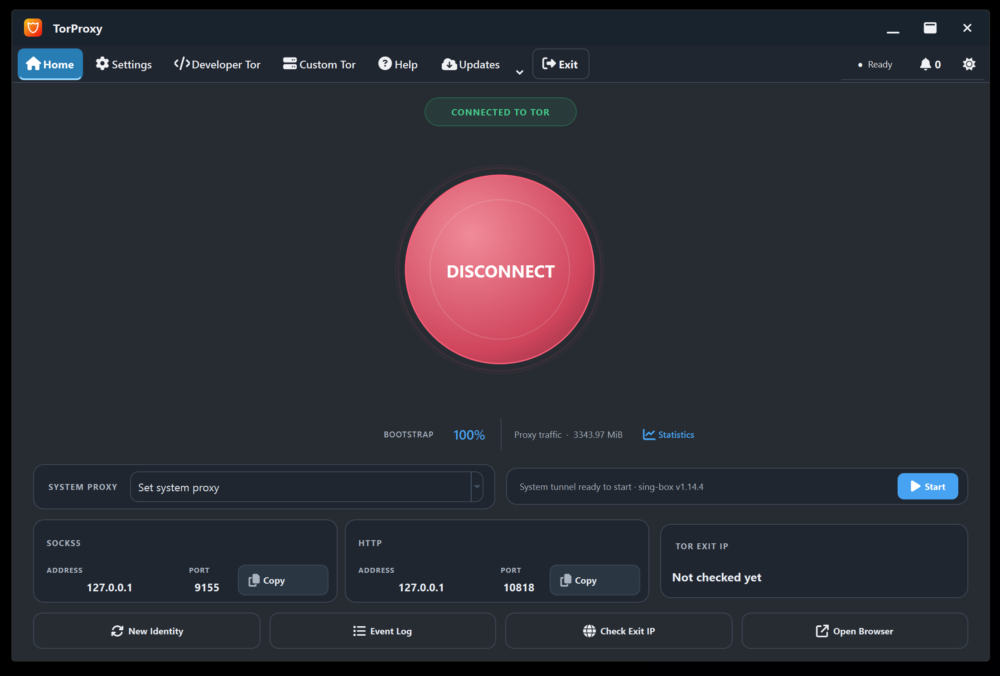
  
<em>The main dashboard — connection status, controls, and local proxy access.</em>

<table>
  <tr>
    <td align="center" width="50%">
      <strong>Custom Tor profiles</strong> 
      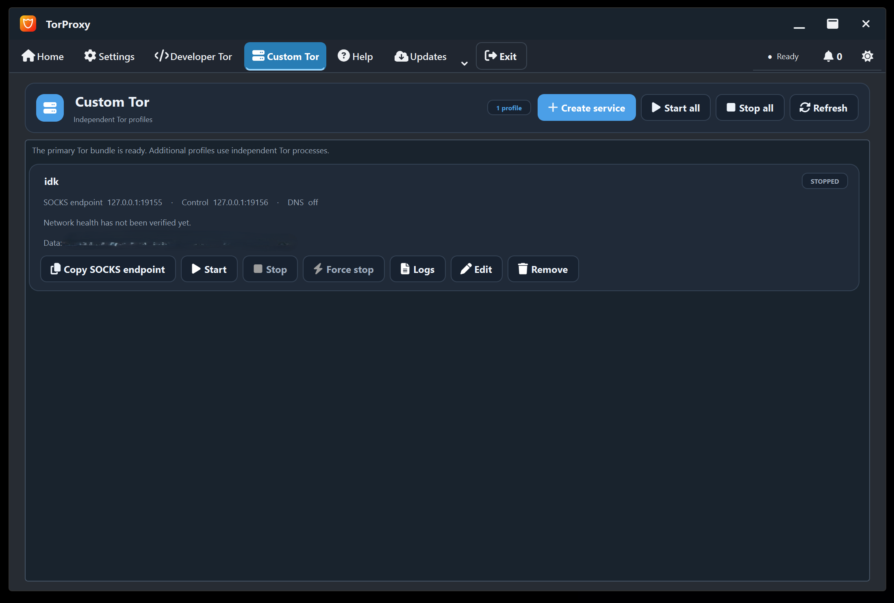
    </td>
    <td align="center" width="50%">
      <strong>Developer Tor & Onion Hosting</strong> 
      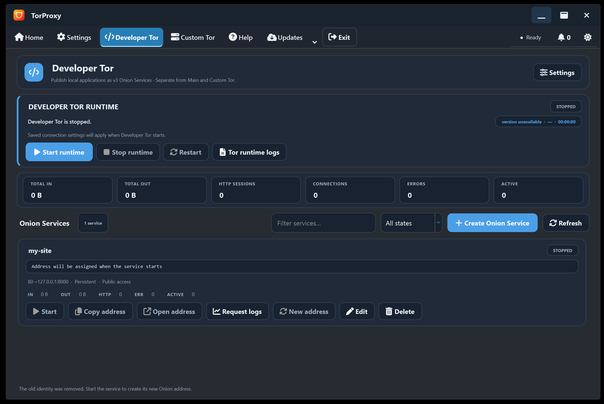
    </td>
  </tr>
  <tr>
    <td align="center" width="50%">
      <strong>Open Browser</strong> 
      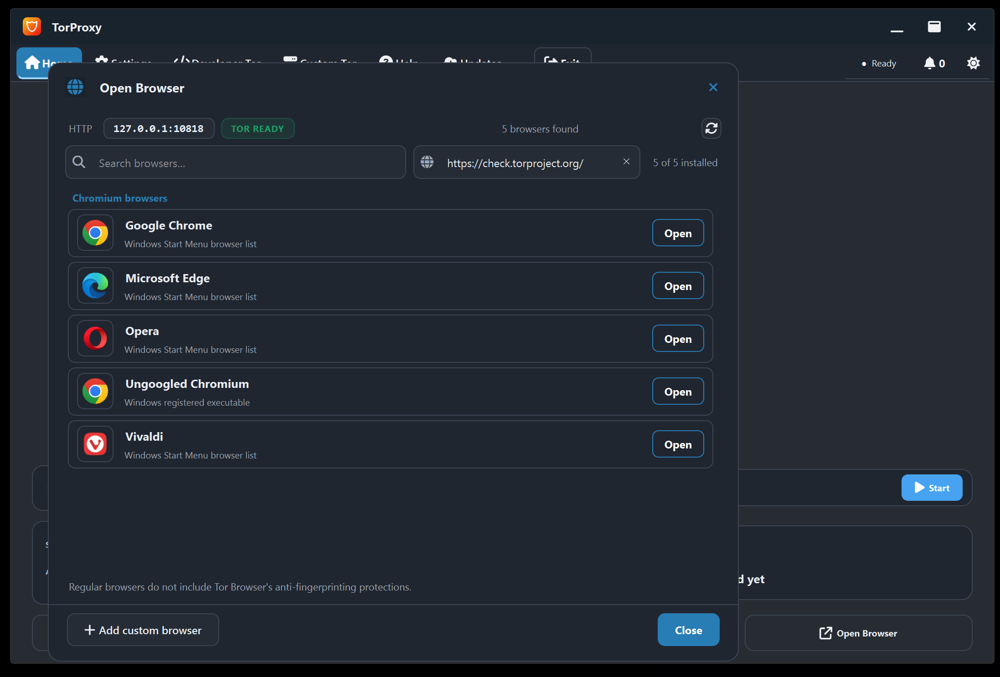
    </td>
    <td align="center" width="50%">
      <strong>Settings</strong> 
      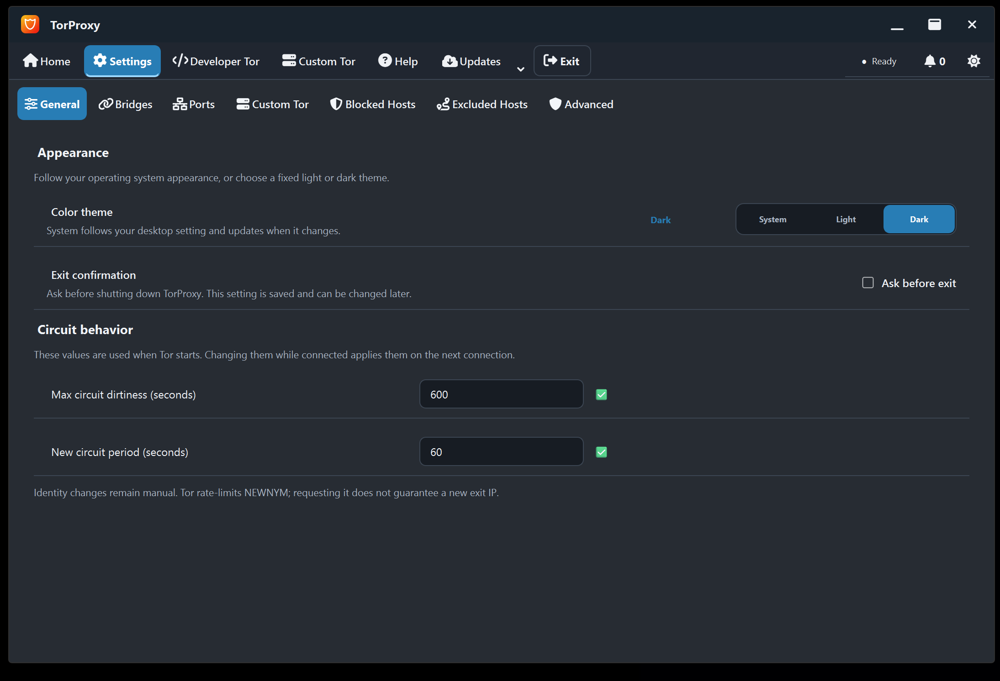
    </td>
  </tr>
  <tr>
    <td align="center" width="50%">
      <strong>Tor Bundle manager</strong> 
      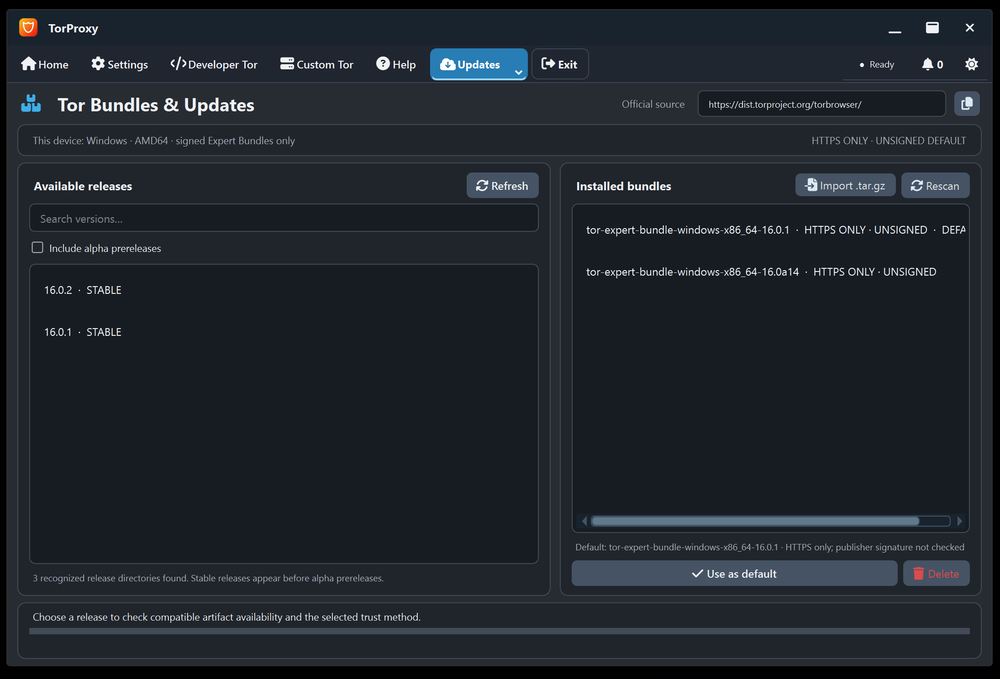
    </td>
    <td align="center" width="50%">
      <strong>System tunnel</strong> 
      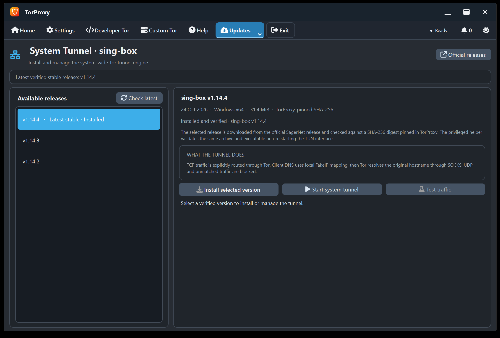
    </td>
  </tr>
</table>

  
More screenshots

  
<strong>Home dashboard</strong>

  

    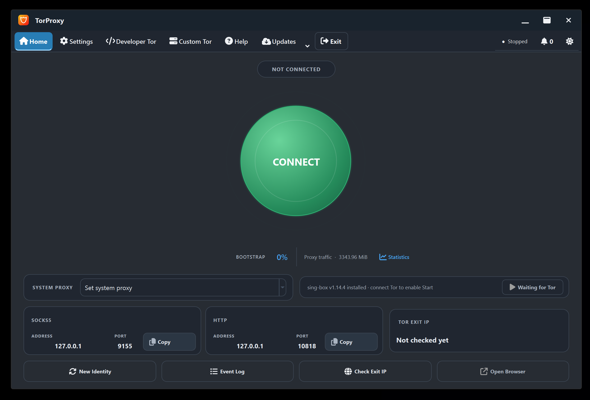
    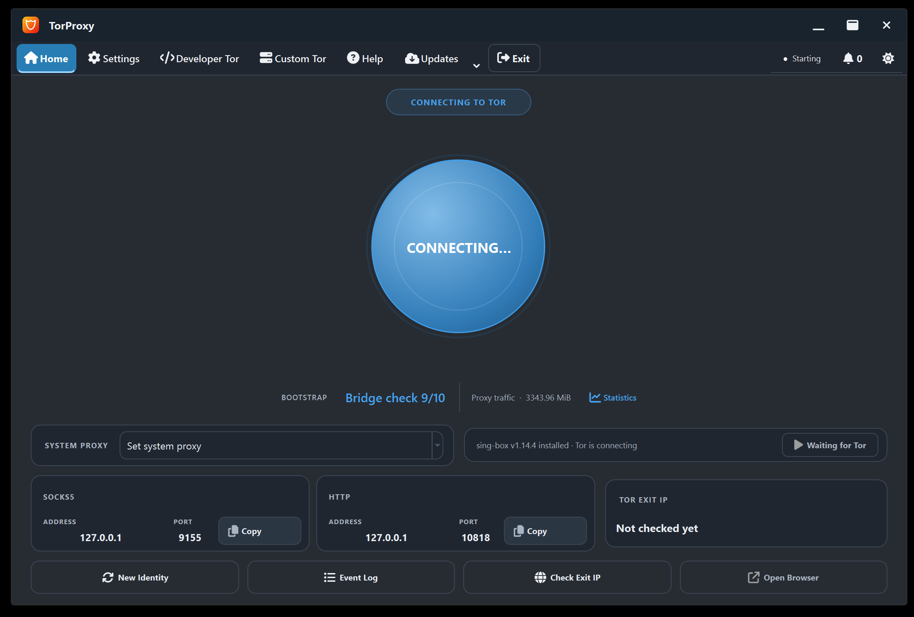
  

  

    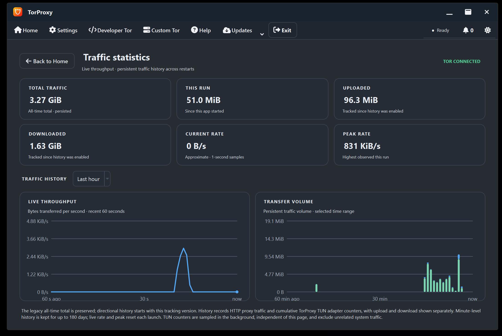
    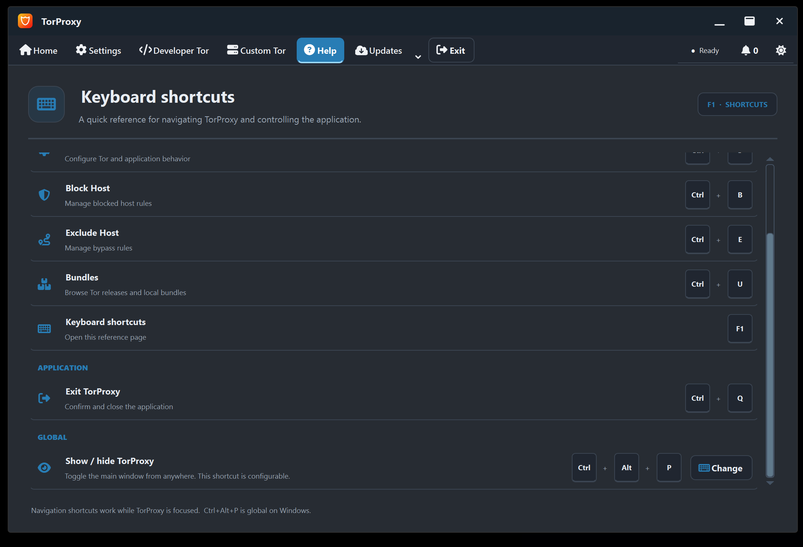
  

## 💻 Download

Get the latest portable build from **[GitHub Releases](https://github.com/nima-salamat/tor-proxy/releases)**.

| Package | Description |
|---|---|
| **Windows x64** | Portable app, without a preinstalled Tor bundle |
| **Windows x64 · With Tor** | Portable app with a verified Tor Expert Bundle |
| **Linux x86_64** | Portable app, without a preinstalled Tor bundle |
| **Linux x86_64 · With Tor** | Portable app with a verified Tor Expert Bundle |

The **With Tor** packages also include the pinned sing-box engine used by the optional system tunnel. Portable packages include the application runtime; a separate Python installation is not required.

- **Windows:** extract the complete archive and run \`TorProxyLauncher.exe\`.
- **Linux:** extract the archive and run \`./TorProxy/TorProxyLauncher\`.

See [release notes](https://github.com/nima-salamat/tor-proxy/releases) for package changes and checksums.

## 🚀 Quick start

1. Download and extract the package for your operating system.
2. Launch TorProxy. When using a package without Tor, open the bundle manager and install a compatible Tor Expert Bundle.
3. Press **Connect** and wait until the application reports **READY**.
4. In the application you want to route, configure its HTTP and HTTPS proxy to the loopback address and port shown by TorProxy. You can also use its displayed SOCKS5 endpoint.
5. Use **What is my IP?** in TorProxy to test the configured HTTP proxy route.

The local proxy endpoints are intended for the same computer and bind to loopback by default. Do not expose the HTTP proxy, SOCKS endpoint, or ControlPort to a LAN.

For a development checkout:

\`\`\`bash
git clone https://github.com/nima-salamat/tor-proxy.git
cd tor-proxy
python -m venv .venv
# Activate the virtual environment, then:
python -m pip install --upgrade pip
python -m pip install -e ".[dev]"
python main.py
\`\`\`

## 📚 Documentation

The README is the overview. The guides below explain the detailed behavior, configuration, and limitations.

| Guide | What it covers |
|---|---|
| [Documentation index](docs/README.md) | All guides, what each one covers, and where to start. |
| [Tor services](docs/TOR_SERVICES.md) | Main Tor worker pool, health checks, failover, bridge distribution, and independent Custom Tor profiles. |
| [Developer Tor & Onion Hosting](docs/ONION_HOSTING.md) | Separate Developer Tor runtime, v3 Onion Services, port mappings, private access, keys, traffic, and lifecycle. |
| [Security design](docs/SECURITY.md) | Listener boundaries, proxy routing, DNS, browser limitations, bundle trust, and tunnel boundaries. |
| [Configuration reference](docs/CONFIGURATION.md) | Settings, storage locations, ports, host rules, bridges, and bundle trust options. |
| [Architecture](docs/ARCHITECTURE.md) | Components, process lifecycle, thread boundaries, persistence, browser launch, and system tunnel design. |
| [Troubleshooting](docs/TROUBLESHOOTING.md) | Startup, bridges, proxy errors, bundle verification, system tunnel, and recovery steps. |
| [Project report](docs/PROJECT_REPORT.md) | Redesign summary, audit findings, validation evidence, and known limitations. |
| [Contributing](CONTRIBUTING.md) | Development setup, coding expectations, checks, and pull-request guidance. |

## ⚠️ Privacy & limitations

- **A proxy is not a firewall.** An application can ignore its proxy settings or use another network path.
- **Excluded hosts bypass Tor.** Use Exclude rules only when a direct connection is intentional.
- **The system tunnel is TCP-only.** Arbitrary UDP, QUIC, and UDP-based applications are not carried through Tor; unsupported UDP is rejected.
- **Open Browser is not Tor Browser.** Normal browsers retain their own fingerprinting and application-level privacy limitations.
- **An Onion Service does not anonymize its hosted application.** Application content, headers, logs, analytics, and external resources can reveal information.
- **NEWNYM does not promise a new exit IP.** Existing connections can continue on their current circuits.

Read the [security design](docs/SECURITY.md) and [security policy](SECURITY.md) for the full boundaries and responsible vulnerability-reporting process.

## 🧪 Development

Install the development dependencies with \`python -m pip install -e ".[dev]"\`.

\`\`\`bash
ruff check src/torproxy tests --select E,F,UP --ignore E501
pytest --cov=torproxy.host_rules --cov=torproxy.ip_check --cov-report=term-missing --cov-fail-under=75
\`\`\`

The CI workflow targets Windows and Ubuntu with Python 3.10–3.13. Check the [Actions page](https://github.com/nima-salamat/tor-proxy/actions) for current results; CI tests do not prove real-world anonymity or every OS integration.

## 📄 License

TorProxy is released under the [MIT License](LICENSE).
