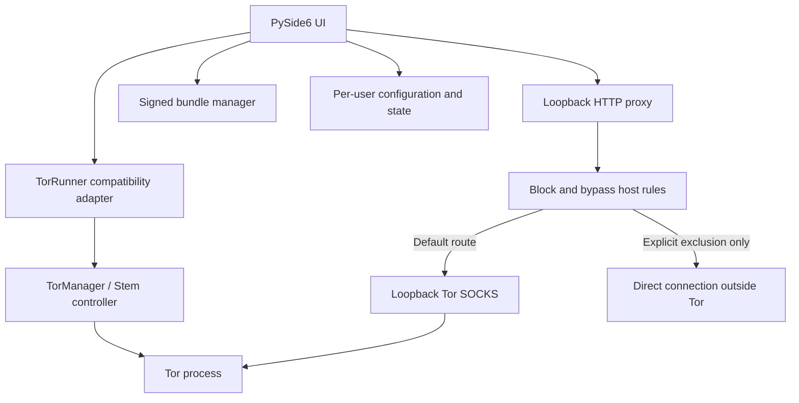

# TorProxy

TorProxy is a PySide6 desktop front-end for running a locally managed Tor process and exposing a loopback-only HTTP proxy to applications that support manual proxy configuration.

The project is being modernized from a flat desktop utility into a testable Python core with safer Tor lifecycle management, validated host policy, verified bundle installation, and reversible system-proxy integration.

> **Privacy and security note:** TorProxy is not a guarantee of anonymity. It protects only traffic that is actually routed through its Tor-backed proxy. Applications can make direct connections, leak information at the application layer, or retain identifying state. Read [the security model](docs/SECURITY.md) before relying on it.

## Features

- Start/stop supervision for an application-owned Tor process, with bounded startup and shutdown.
- Loopback-only SOCKS, ControlPort, DNSPort (when configured), and HTTP proxy listeners.
- Stem-based Tor control with cookie authentication, bootstrap status, process-identity checks, and rate-limited `NEWNYM` requests.
- HTTP forwarding and HTTPS `CONNECT` tunnels through Tor's SOCKS endpoint, with remote DNS for Tor-routed destinations.
- Immutable block/bypass host-rule snapshots shared by HTTP and CONNECT.
- An IP-check action that uses the configured local HTTP proxy and **does not retry directly**.
- Explicit opt-in for system proxy changes, snapshot-based restoration, and protection against overwriting later external changes.
- Tor Expert Bundle downloads restricted to official Tor distribution hosts and verified against a pinned OpenPGP signing-key fingerprint before extraction.
- Versioned configuration, per-user writable data paths, atomic settings writes, tests, and CI.

## Architecture



The new, independently testable code lives in `src/torproxy/`. Existing UI modules continue to use a small compatibility layer while migration progresses. See [Architecture](docs/ARCHITECTURE.md) for lifecycle and thread boundaries.

## Requirements and support status

| Area | Current policy |
|---|---|
| Python | `>=3.10`, as declared in `pyproject.toml` |
| Desktop UI | PySide6 |
| Bundle downloader | Windows/Linux, x86_64 or 32-bit x86 Expert Bundles |
| System proxy integration | Windows user Internet Settings; GNOME `gsettings` on Linux |
| macOS | Not currently supported by the bundle downloader or system-proxy adapter |
| CPU/OS validation | GitHub Actions is configured for Windows and Ubuntu on Python 3.10–3.13; check the [Actions page](https://github.com/nima-salamat/tor-proxy/actions) for actual results |

The matrix describes intended CI coverage, not a claim that every platform has been manually tested. Arbitrary user-supplied Tor executables may work, but are not part of the bundle downloader's supported matrix.

## Install and run

### Prerequisites

Install Python 3.10 or newer. Bundle signature verification requires GnuPG (`gpg`). On Debian/Ubuntu, the optional QR-code feature needs native ZBar:

```bash
sudo apt-get update
sudo apt-get install -y gnupg libzbar0
```

On Windows, install GnuPG from a trusted distribution and ensure `gpg.exe` is on `PATH`, or configure `TORPROXY_GPG_EXECUTABLE` with its full path. Some platforms require additional native setup for QR decoding; see [Troubleshooting](docs/TROUBLESHOOTING.md).

### Development installation

```bash
git clone https://github.com/nima-salamat/tor-proxy.git
cd tor-proxy
python -m venv .venv
```

Activate the virtual environment, then run:

```bash
python -m pip install --upgrade pip
python -m pip install -e ".[dev]"
python main.py
```

A legacy-compatible runtime dependency file is also provided:

```bash
python -m pip install -r requirements.txt
```

The first launch migrates an existing root-level `config.json` into the per-user configuration directory when possible. Invalid configuration is reported rather than silently treated as a successful load.

## Get a Tor bundle

1. Open the application's Tor bundle/update view.
2. Retrieve the official release list.
3. Select a release for the current supported OS/CPU.
4. Confirm download and wait for signature verification and safe extraction to finish.
5. Select the verified local bundle as the default Tor executable.

Downloads are stored in the current user's application-data directory, not inside the installed source tree. The downloader refuses unsigned or invalid artifacts, unsupported archive entries, and path traversal. GnuPG is required; verification failures stop installation.

Older repository versions included large archives in `bundles/`. These are no longer required in source control. Existing local archives that lack a verifiable `.asc` signature are not automatically trusted by the updater; download a verified bundle again, or explicitly select a local Tor executable whose origin you trust.

## Release channels and bundle verification

The updater recognizes numeric stable releases (for example, `15.0.26`) and the supported alpha naming convention (for example, `16.0a14`). Stable releases are prioritized; alpha releases are labelled as prereleases and can be hidden with the prerelease filter. A release directory is not considered downloadable unless the exact current-platform Expert Bundle and its matching detached `.asc` signature are both listed. Tor Browser installers, `.mar` updates, debug archives and checksum files are not substitutes for an Expert Bundle.

The bundle page displays transfer bytes and, when the server advertises a usable `Content-Length`, percentage, speed and an approximate remaining-time estimate. Unknown transfer lengths use an indeterminate progress bar. Signature verification, archive extraction and installation are shown as distinct stages; a completed transfer alone never counts as an installed bundle. Cancellation is available during archive/signature transfer and is disabled during stages that cannot be safely interrupted.

Signature verification is mandatory and checks the detached signature against the independently pinned Tor signing-key fingerprint. TorProxy discovers GnuPG from `PATH`, common installation paths, or `TORPROXY_GPG_EXECUTABLE` (the full path to `gpg.exe` or `gpg`). If no verifier can be started, installation stops and reports the supported recovery path; verification is never bypassed.

## Start Tor and configure an application

1. Start TorProxy and select **Connect**.
2. Wait for bootstrap to reach 100%. The application checks the managed Tor ControlPort and SOCKS listener separately from the local HTTP proxy.
3. Use the HTTP proxy endpoint displayed by TorProxy. It listens on `127.0.0.1`; configure both HTTP and HTTPS proxy fields in your application to `127.0.0.1:<shown-proxy-port>`.
4. Test with **What is my IP?**. It sends an HTTPS request through the local proxy and reports the observed exit IP only if the proxied request succeeds.

Do not expose the local HTTP proxy, SOCKS port, or ControlPort to a LAN. The application deliberately rejects non-loopback HTTP proxy binds.

## Identity requests

Choose **Change Identity** to request Tor's `NEWNYM` signal. The application consults Stem's cooldown information and does not start a repeating timer by default.

A successful `NEWNYM` command means Tor accepted an identity/circuit request; it does **not** guarantee a different public IP. Existing TCP connections can continue using their existing circuits. See [Stem's controller API](https://tpo.pages.torproject.net/network-health/stem/api/control.html) for details.

## Bridges and advanced settings

Bridge mode accepts bridge records whose transport is explicitly recognized by the current validator (obfs4, Snowflake, WebTunnel, or meek_lite). The selected Tor bundle must contain the corresponding pluggable-transport executable. Incorrect records or missing transport binaries are errors; they are not silently ignored.

The supervised Tor configuration currently supports circuit dirtiness, new-circuit period, IPv4/IPv6 client behavior, bridge records, and local listener endpoints. Country-specific `ExitNodes`/`StrictNodes` controls are not presented as supported UI features in this redesign. Avoid unreviewed Tor directives.

## Blocked hosts and exclusions

Host rules match a root domain and its subdomains by default. Prefix `=` for an exact hostname only, and `*.` for subdomains only. Rules are normalized with IDNA and IP-literal handling. Blocking is applied consistently to HTTP and HTTPS CONNECT requests.

Excluded hosts are a deliberate bypass: TorProxy connects to them directly. That can reveal the destination and DNS lookup to the local network/ISP and expose your direct IP. Leave exclusions empty unless you intentionally want this behavior. Block rules take precedence over exclusions.

## System proxy settings

System proxy changes are **manual and disabled by default**. Tor startup never changes global settings automatically.

The system-proxy control currently supports Windows Internet Settings and GNOME `gsettings`. Before changing settings, TorProxy saves the previous values. On clear/shutdown, it restores them only when it can confirm the settings still match the values it applied. If another application changed them in the meantime, TorProxy leaves those external changes untouched and reports that manual inspection may be required. macOS integration is not implemented.

Applications configured manually to use `127.0.0.1:<shown-proxy-port>` do not require system-wide proxy changes.

## Configuration and data paths

Settings, application state, logs, and downloaded bundles live in per-user locations rather than the source checkout. Defaults and supported legacy keys are described in [Configuration](docs/CONFIGURATION.md).

Traffic usage counts bytes observed in both directions for proxied HTTP requests and CONNECT tunnels. It is an application-level counter, not a total network-usage meter; under extreme bursts, the bounded counter queue can drop updates and log a warning.

## Security and limitations

- The default HTTP proxy, SOCKS, ControlPort, and DNS listeners bind to loopback.
- The ControlPort is cookie-authenticated; the controller must identify the Tor process launched by this application.
- The IP checker has no direct-network fallback.
- Downloads fail closed when a signature, trusted key, or safe extraction check fails.
- Logs avoid recording request URLs and query strings, but local logs and host-rule lists should still be treated as user data.
- Direct exclusions intentionally bypass Tor.
- System-proxy restoration can fail safely if another program changes settings.
- This is not a firewall or system-wide traffic-enforcement mechanism. An application can ignore the proxy.
- CI tests use fakes/local servers; they do not prove real-world anonymity or verify every OS integration.

Read [Security](docs/SECURITY.md) and [Troubleshooting](docs/TROUBLESHOOTING.md) before reporting an issue.

## Development and testing

```bash
python -m pip install -e ".[dev]"
ruff check src/torproxy tests --select E,F,UP --ignore E501
pytest --cov=torproxy.host_rules --cov=torproxy.ip_check --cov-report=term-missing --cov-fail-under=75
```

The offline suite also exercises stable/alpha release parsing, exact artifact/signature selection, transfer progress/cancellation, GnuPG failure modes, and atomic installation-marker publication. Normal CI does not download a real Tor archive.

An opt-in integration test contacts the official Tor Project distribution, downloads a compatible Expert Bundle, and verifies its real detached signature. It requires GnuPG, internet access, and a supported OS/architecture. Do not enable it in an untrusted test environment because it downloads a large archive.

On Linux/macOS shells with a supported runtime:

```bash
TORPROXY_ONLINE_SIGNATURE_TEST=1 pytest -m integration tests/test_updater_pipeline.py::test_live_official_expert_bundle_download_and_signature
```

In Windows PowerShell:

```powershell
$env:TORPROXY_ONLINE_SIGNATURE_TEST = "1"
pytest -m integration tests/test_updater_pipeline.py::test_live_official_expert_bundle_download_and_signature
```

A skipped opt-in test is not evidence of a verified download. Record the actual test result and platform when reporting integration validation.

See [Contributing](CONTRIBUTING.md), [Changelog](CHANGELOG.md), and the [project report](docs/PROJECT_REPORT.md).

## License

MIT. See [LICENSE](LICENSE).
