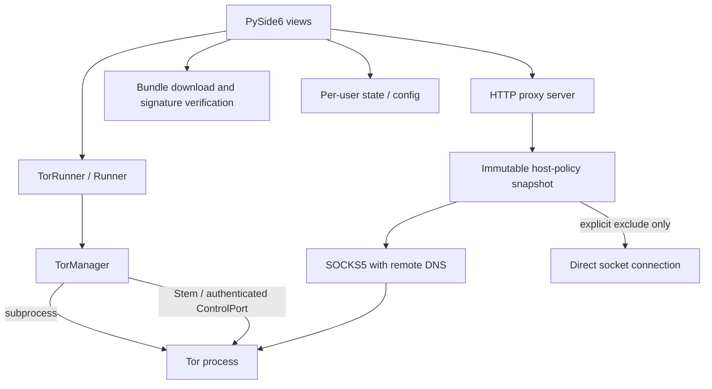

# Architecture

## Components

## Process lifecycle

`TorManager` owns only the subprocess it creates. It validates the executable and generated torrc, uses Tor's configuration verification mode before launch, redirects child output to a file rather than leaving pipes undrained, and polls the process while waiting for the authenticated ControlPort and bootstrap status. Startup has a deadline. Shutdown requests termination of the managed child, waits a bounded interval, then force-terminates if required.

States are `STOPPED`, `STARTING`, `BOOTSTRAPPING`, `READY`, `STOPPING`, and `FAILED`. `READY` means Tor reported a completed bootstrap, the ControlPort responded after authentication, the control endpoint identified the managed PID, and the SOCKS TCP listener accepted a connection. It does not mean every destination is reachable; the proxied IP check tests a real request separately.

The HTTP proxy is an independent local service. It is loopback-only. HTTP absolute-form requests and HTTPS CONNECT share one hostname policy. Normal traffic goes through the configured SOCKS endpoint with remote DNS; excluded hosts take an explicit direct route. Blocked hosts are rejected before upstream connection attempts.

## Thread boundaries

- Qt widgets are created and updated on the GUI thread.
- `TorRunner` runs blocking supervisor work on a dedicated Python thread and emits Qt signals for logs and failures.
- HTTP requests run in handler threads.
- HTTP request handlers run in threads because proxy work is predominantly socket I/O; the local listener and its lifecycle remain in a dedicated background thread.
- The traffic tracker drains a bounded, non-blocking byte-event queue and persists totals plus minute-level upload/download history to a per-user SQLite database on its own background thread. It never writes to disk from a socket handler; old minute buckets are pruned after 180 days.
- Network requests and bundle installation run in UI worker tasks; results/errors return through worker signals.
- TorProxy-owned HTTP requests share an explicit-route client. When Tor is READY, release discovery, artifact checks, archive/signature downloads, and pinned-key retrieval use the live loopback SOCKS5H endpoint with remote DNS. Direct bootstrap is available only after a per-operation user confirmation and is blocked while the system-wide Kill Switch is enabled; a failed Tor request never falls back to direct networking.

Avoid calling widgets directly from a worker. Status and log updates should be delivered to Qt slots through signals. Some old UI helpers remain transitional and need the same review as the rest of the UI migration.

## Browser launch and persistent listener ports

`src/torproxy/ports.py` owns the four listener assignments. On first launch, automatic ports are selected from the OS ephemeral range and saved together through the existing atomic per-user config writer. The Tor DNSPort assignment is checked for both TCP and UDP conflicts. On subsequent launches the saved ports are probed and reused. If an automatically assigned port has been claimed by another process, a replacement is selected and persisted. A user-pinned port (`*_checked=true`) is never silently changed; a conflict is reported during connection preflight. Ports are probed and released before their real owners bind, so the OS bind remains authoritative and preflight is repeated before each connection attempt.

`src/torproxy/browsers/` separates browser detection, profile management and launch behavior. Windows discovery uses App Paths and standard install locations. Linux discovery parses XDG Desktop Entry `Exec` values without a shell and honors PATH/Flatpak/Snap launch wrappers when present. Chromium and Firefox use separate launch adapters and per-browser profile directories scoped to the effective proxy port. If an automatic port changes while an older browser process is still running, a new profile prevents Chromium from silently reusing the old process with stale proxy arguments. User-added executables are persisted separately in the user configuration directory.

The browser chooser does not run OS discovery in its constructor. It first loads the last browser snapshot from `BrowserInventoryStore` (SQLite under the per-user data directory), builds the cached rows, then schedules `BrowserDiscoveryWorker` through `QThreadPool.globalInstance()`. The worker enumerates Windows registrations/Start Menu shortcuts or Linux desktop entries, validates executable paths, and commits a replacement snapshot. The UI updates only through queued worker signals. If a cached executable disappears before the worker finishes, the Open action detects that immediately, removes the exact stale database record (and any custom-browser registration), and displays an actionable error. A background refresh preserves valid custom entries added while a scan is in flight.

The Home launcher is gated on the verified `running && connected` state and a live local HTTP listener. The browser process is started detached with an argv list and `shell=False`. Chromium receives one loopback `--proxy-server` without `direct://` and the `--webrtc-ip-handling-policy=disable_non_proxied_udp` WebRTC policy; Firefox receives managed HTTP/HTTPS proxy preferences, sets `network.proxy.failover_direct=false` for system-request failover, and applies proxy-aware ICE restrictions. Its profile-scoped remoting reuses an already-running TorProxy profile; port-specific profile directories isolate a replacement port. The default browser profile and system proxy settings remain untouched.

## Desktop shell and bundle workflow

The current Qt shell retains the existing service-facing widgets and top navigation, adds a consistent page heading, puts the global service-state label in the page header, and applies theme-aware surfaces. The overview remains the place for connect/disconnect, traffic counters, exit-IP checking, system-proxy opt-in and event logs; the configuration page retains ports, bridge records and QR input; host rules and the bundle manager have separate navigation entries. This is an incremental presentation migration, not a claim that every legacy view has moved into a fully separated view-model package.

The bundle manager performs release-directory discovery separately from artifact eligibility. It recognizes the stable `X.Y.Z` and currently supported alpha `X.YaN`/ `X.Y.ZaN` forms, orders stable releases before prereleases, and checks for the exact platform/architecture archive plus a detached signature when OpenPGP is enabled. `BundleProgress` is an immutable event model propagated through the download callback and a Qt signal; widget updates remain in a GUI-thread slot. A missing total transfer length uses indeterminate progress, and the bar does not claim installation success before extraction and installation finish.

OpenPGP publisher-signature verification is enabled by default in Settings → Advanced. When enabled, TorProxy requires the detached signature, checks the full pinned Tor signing-key fingerprint, probes GnuPG before transferring the large archive, and fails closed if verification cannot run. When disabled, the archive is restricted to approved HTTPS hosts and safe extraction still applies, but publisher identity is not authenticated. Installation markers distinguish `openpgp`, `https_only`, and manually imported `local_unverified` bundles; the project does not bundle GnuPG or provide GnuPG-independent OpenPGP verification.

## Persistence and resources

- App configuration is stored in per-user configuration directories.
- Runtime state, logs, and downloaded bundles are stored in per-user writable paths.
- Packaged UI assets remain read-only resources.
- JSON settings and host-rule files use temporary files and atomic replacement.
- A bundle is selectable only after safe extraction, a matching archive SHA-256 marker, and executable/platform checks. Signed downloads/imports are marked `openpgp`; unsigned HTTPS downloads and manual imports retain distinct `https_only` and `local_unverified` trust labels.

## Identity workflow

A manual identity request checks Stem's `get_newnym_wait()`. When Tor reports a cooldown, the UI declines the request and logs the wait; otherwise it sends `NEWNYM`. Neither signal acceptance nor a completed request guarantees an exit-IP change. Existing connections may remain on their current circuits.

## Kill Switch lifecycle

`KillSwitchManager` coordinates platform-specific firewall backends independently of `TorManager`. `ProxyWindow` applies and verifies the firewall policy before launching the local HTTP proxy or Tor. Windows uses a named Defender Firewall rule group and a snapshot of profile defaults/local outbound Allow rules. Linux uses an owned nftables `inet` table and a persistent system service; `TorManager` launches the Tor process in a transient systemd user scope and registers that scope's cgroup ID as the only outbound exception. The desktop user's UID is never exempted.

The firewall remains in default-deny state while Tor is stopped or bootstrapping. On Linux, the cgroup exception is cleared when the managed Tor process stops. On both platforms, disabling Kill Switch explicitly restores the saved firewall policy; a missing or externally modified policy is not blindly overwritten. The HTTP proxy's direct-exclusion route is also disabled while the preference is active.

## System-wide TUN lifecycle

The experimental Home-page tunnel uses a separately installed, version-pinned sing-box engine. The GUI worker downloads the official platform archive, checks its pinned SHA-256, extracts only the executable plus known runtime/license files, checks the engine version, and writes an installation manifest. The privileged helper rechecks the archive hash and compares the on-disk executable with the executable bytes inside that pinned archive before it can start the process.

The generated sing-box config contains one TUN inbound, one local TCP-only SOCKS outbound to Tor, and a DNS-over-HTTPS resolver whose dialer is the Tor SOCKS outbound. TUN DNS is hijacked into the sing-box DNS module. The route order is deliberate: Tor and sing-box executable paths bypass the TUN to avoid a self-routing loop; DNS packets are hijacked; UDP is rejected; all remaining traffic uses Tor SOCKS. The Tor executable and any configured bridge transport remain subject to the existing Kill Switch restrictions.

The existing Kill Switch is a required dependency. Windows adds an outbound Allow rule for the exact TorProxy interface alias; Linux adds the exact nftables output exception for oifname torproxy-tun. Neither rule permits physical-interface traffic. Older Kill Switch installations must be disabled and re-enabled once to install this narrow exception. The tunnel is stopped before Tor, the local SOCKS listener, or the application exits. If its process identity cannot be verified or it cannot be stopped, Tor and the Kill Switch are intentionally left running.
