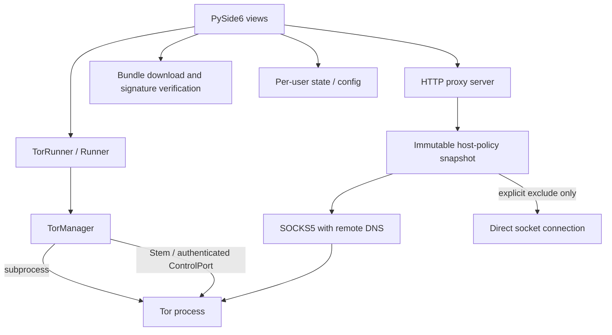

# Architecture

## Components

## Process lifecycle

`TorManager` owns only the subprocess it creates. It validates the executable and generated torrc, uses Tor's configuration verification mode before launch, redirects child output to a file rather than leaving pipes undrained, and polls the process while waiting for the authenticated ControlPort and bootstrap status. Startup has a deadline. Shutdown requests termination of the managed child, waits a bounded interval, then force-terminates if required.

States are `STOPPED`, `STARTING`, `BOOTSTRAPPING`, `READY`, `STOPPING`, and `FAILED`. `READY` means Tor reported a completed bootstrap, the ControlPort responded after authentication, the control endpoint identified the managed PID, and the SOCKS TCP listener accepted a connection. It does not mean every destination is reachable; the proxied IP check tests a real request separately.

The HTTP proxy is an independent local service. It is loopback-only. HTTP absolute-form requests and HTTPS CONNECT share one hostname policy. Normal traffic goes through the configured SOCKS endpoint with remote DNS; excluded hosts take an explicit direct route. Blocked hosts are rejected before upstream connection attempts.

## Thread boundaries

- Qt widgets are created and updated on the GUI thread.
- `TorRunner` runs blocking supervisor work on a dedicated Python thread and emits Qt signals for logs and failures.
- HTTP requests run in handler threads.
- The traffic tracker drains a bounded byte-event queue and persists aggregate counters periodically.
- Network requests and bundle installation run in UI worker tasks; results/errors return through worker signals.

Avoid calling widgets directly from a worker. Status and log updates should be delivered to Qt slots through signals. Some old UI helpers remain transitional and need the same review as the rest of the UI migration.

## Desktop shell and bundle workflow

The current Qt shell retains the existing service-facing widgets and top navigation, adds a consistent page heading, puts the global service-state label in the page header, and applies theme-aware surfaces. The overview remains the place for connect/disconnect, traffic counters, exit-IP checking, system-proxy opt-in and event logs; the configuration page retains ports, bridge records and QR input; host rules and the bundle manager have separate navigation entries. This is an incremental presentation migration, not a claim that every legacy view has moved into a fully separated view-model package.

The bundle manager performs release-directory discovery separately from artifact eligibility. It recognizes the stable `X.Y.Z` and currently supported alpha `X.YaN`/ `X.Y.ZaN` forms, orders stable releases before prereleases, and checks for the exact platform/architecture archive plus detached signature only when a release is selected. `BundleProgress` is an immutable event model propagated through the download callback and a Qt signal; widget updates remain in a GUI-thread slot. A missing total transfer length uses indeterminate progress, and the bar does not claim installed status before signature verification and extraction finish.

The verifier continues to require the independently pinned full Tor signing-key fingerprint and a detached OpenPGP signature. GnuPG discovery checks `PATH`, common install locations and `TORPROXY_GPG_EXECUTABLE`. The downloader probes the GnuPG runtime before receiving the large archive, then checks the pinned fingerprint and the exact detached signature. If a supported GnuPG runtime cannot be started, the operation fails closed with recovery guidance; the current implementation does not bundle GnuPG and does not provide GnuPG-independent verification.

## Persistence and resources

- App configuration is stored in per-user configuration directories.
- Runtime state, logs, and downloaded bundles are stored in per-user writable paths.
- Packaged UI assets remain read-only resources.
- JSON settings and host-rule files use temporary files and atomic replacement.
- A downloaded Tor bundle is considered a managed/verified installation only when its detached signature is valid, archive digest is recorded, and verification marker is written in an isolated staging directory before the directory is atomically published at its final name.

## Identity workflow

A manual identity request checks Stem's `get_newnym_wait()`. When Tor reports a cooldown, the UI declines the request and logs the wait; otherwise it sends `NEWNYM`. Neither signal acceptance nor a completed request guarantees an exit-IP change. Existing connections may remain on their current circuits.
