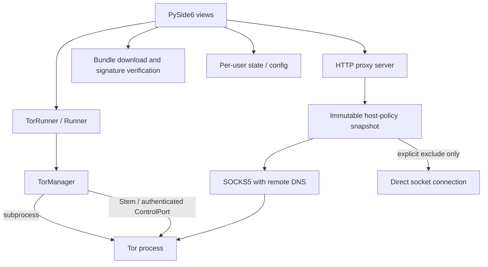

# Architecture

## Components

## Process lifecycle

`TorManager` owns only the subprocess it creates. It validates the executable and generated torrc, uses Tor's configuration verification mode before launch, redirects child output to a file rather than leaving pipes undrained, and polls the process while waiting for the authenticated ControlPort and bootstrap status. Startup has a deadline. Shutdown requests termination of the managed child, waits a bounded interval, then force-terminates if required.

States are `STOPPED`, `STARTING`, `BOOTSTRAPPING`, `READY`, `STOPPING`, and `FAILED`. `READY` means Tor reported a completed bootstrap, the ControlPort responded after authentication, the control endpoint identified the managed PID, and the SOCKS TCP listener accepted a connection. It does not mean every destination is reachable; the proxied IP check tests a real request separately.

The HTTP proxy is an independent local service. It is loopback-only. HTTP absolute-form requests and HTTPS CONNECT share one hostname policy. Normal traffic goes through the configured SOCKS endpoint with remote DNS; excluded hosts take an explicit direct route. Blocked hosts are rejected before upstream connection attempts.

## Thread boundaries

- Qt widgets are created and updated on the GUI thread.
- `TorRunner` runs blocking supervisor work on a dedicated Python thread and emits Qt signals for logs and failures.
- HTTP requests run in handler threads.
- HTTP request handlers run in threads because proxy work is predominantly socket I/O; the local listener and its lifecycle remain in a dedicated background thread.
- The traffic tracker drains a bounded, non-blocking byte-event queue and persists totals plus minute-level upload/download history to a per-user SQLite database on its own background thread. It never writes to disk from a socket handler; old minute buckets are pruned after 180 days.
- Network requests and bundle installation run in UI worker tasks; results/errors return through worker signals.
- TorProxy-owned HTTP requests share an explicit-route client. When Tor is READY, release discovery, artifact checks, archive/signature downloads, and pinned-key retrieval use the live loopback SOCKS5H endpoint with remote DNS. When Tor is not READY, direct bootstrap requires a separate per-operation user confirmation; a failed Tor request never falls back to direct networking.

Avoid calling widgets directly from a worker. Status and log updates should be delivered to Qt slots through signals. Some old UI helpers remain transitional and need the same review as the rest of the UI migration.

## Browser launch and persistent listener ports

`src/torproxy/ports.py` owns the four listener assignments. On first launch, automatic ports are selected from the OS ephemeral range and saved together through the existing atomic per-user config writer. The Tor DNSPort assignment is checked for both TCP and UDP conflicts. On subsequent launches the saved ports are probed and reused. If an automatically assigned port has been claimed by another process, a replacement is selected and persisted. A user-pinned port (`*_checked=true`) is never silently changed; a conflict is reported during connection preflight. Ports are probed and released before their real owners bind, so the OS bind remains authoritative and preflight is repeated before each connection attempt.

`src/torproxy/browsers/` separates browser detection, profile management and launch behavior. Windows discovery uses App Paths and standard install locations. Linux discovery parses XDG Desktop Entry `Exec` values without a shell and honors PATH/Flatpak/Snap launch wrappers when present. Chromium and Firefox use separate launch adapters and per-browser profile directories scoped to the effective proxy port. If an automatic port changes while an older browser process is still running, a new profile prevents Chromium from silently reusing the old process with stale proxy arguments. User-added executables are persisted separately in the user configuration directory.

The browser chooser does not run OS discovery in its constructor. It first loads the last browser snapshot from `BrowserInventoryStore` (SQLite under the per-user data directory), builds the cached rows, then schedules `BrowserDiscoveryWorker` through `QThreadPool.globalInstance()`. The worker enumerates Windows registrations/Start Menu shortcuts or Linux desktop entries, validates executable paths, and commits a replacement snapshot. The UI updates only through queued worker signals. If a cached executable disappears before the worker finishes, the Open action detects that immediately, removes the exact stale database record (and any custom-browser registration), and displays an actionable error. A background refresh preserves valid custom entries added while a scan is in flight.

The Home launcher is gated on the verified `running && connected` state and a live local HTTP listener. The browser process is started detached with an argv list and `shell=False`. Chromium receives one loopback `--proxy-server` without `direct://` and the `--webrtc-ip-handling-policy=disable_non_proxied_udp` WebRTC policy; Firefox receives managed HTTP/HTTPS proxy preferences, sets `network.proxy.failover_direct=false` for system-request failover, and applies proxy-aware ICE restrictions. Its profile-scoped remoting reuses an already-running TorProxy profile; port-specific profile directories isolate a replacement port. The default browser profile and system proxy settings remain untouched.

## Desktop shell and bundle workflow

The current Qt shell retains the existing service-facing widgets and top navigation, adds a consistent page heading, puts the global service-state label in the page header, and applies theme-aware surfaces. The overview remains the place for connect/disconnect, traffic counters, exit-IP checking, system-proxy opt-in and event logs; the configuration page retains ports, bridge records and QR input; host rules and the bundle manager have separate navigation entries. This is an incremental presentation migration, not a claim that every legacy view has moved into a fully separated view-model package.

The bundle manager performs release-directory discovery separately from artifact eligibility. It recognizes the stable `X.Y.Z` and currently supported alpha `X.YaN`/ `X.Y.ZaN` forms, orders stable releases before prereleases, and checks for the exact platform/architecture archive plus a detached signature when OpenPGP is enabled. `BundleProgress` is an immutable event model propagated through the download callback and a Qt signal; widget updates remain in a GUI-thread slot. A missing total transfer length uses indeterminate progress, and the bar does not claim installation success before extraction and installation finish.

OpenPGP publisher-signature verification is optional and disabled by default in Settings → Advanced. In the default mode, TorProxy downloads from approved Tor Project HTTPS hosts and always performs safe extraction, but does not require GnuPG or a detached signature; publisher identity is not authenticated. When users explicitly enable OpenPGP, TorProxy requires the detached signature, checks the full pinned Tor signing-key fingerprint, probes GnuPG before transferring the large archive, and fails closed if verification cannot run. Installation markers distinguish `openpgp`, `https_only`, and manually imported `local_unverified` bundles; the project does not bundle GnuPG or provide GnuPG-independent OpenPGP verification.

## Persistence and resources

- App configuration is stored in per-user configuration directories.
- Runtime state, logs, and downloaded bundles are stored in per-user writable paths.
- Packaged UI assets remain read-only resources.
- JSON settings and host-rule files use temporary files and atomic replacement.
- A bundle is selectable only after safe extraction, a matching archive SHA-256 marker, and executable/platform checks. Signed downloads/imports are marked `openpgp`; unsigned HTTPS downloads and manual imports retain distinct `https_only` and `local_unverified` trust labels.

## Identity workflow

A manual identity request checks Stem's `get_newnym_wait()`. When Tor reports a cooldown, the UI declines the request and logs the wait; otherwise it sends `NEWNYM`. Neither signal acceptance nor a completed request guarantees an exit-IP change. Existing connections may remain on their current circuits.

## Legacy firewall configuration

The desktop no longer exposes or activates the optional system-wide Kill Switch. The legacy `kill_switch_enabled` configuration key is accepted only so older configuration files can still be parsed; current Tor startup, direct-exclusion routing, bundle downloads, and the system tunnel do not consult it. The firewall backend is not part of the active application flow.

## System-wide TUN lifecycle

The system tunnel is managed as a dedicated page under **Updates → Tunnel**, next to the Tor Expert Bundle manager. The GUI worker downloads a selected stable sing-box release, verifies the archive against its pinned platform SHA-256, extracts only allowlisted executable/runtime/license files, checks the executable's reported version, and writes an installation manifest. The privileged helper receives the selected version and independently rechecks the archive digest, runtime-file digests, executable identity, and generated config before starting sing-box. The UI lists every release pinned by the current TorProxy build and can query GitHub for the latest stable release; an upstream version without a reviewed digest is displayed but cannot be installed. Tunnel release checks and engine downloads use the local SOCKS5H route when Tor is READY; otherwise, each direct bootstrap request requires a separate user confirmation. Neither operation falls back to a direct route after a Tor failure.

The generated sing-box config contains one TUN inbound, one local TCP-only SOCKS outbound to Tor, a FakeIP DNS server for client queries, and a DNS-over-HTTPS resolver for internal domain-resolution needs. Client DNS is answered from FakeIP ranges with reverse mapping enabled: when an application connects to a synthetic address, sing-box restores the original hostname and the SOCKS5 request lets Tor resolve it at the exit. The DoH server is pinned to the IP literal `1.1.1.1`, tagged `tor-doh`, and explicitly selected as `route.default_domain_resolver`; sing-box 1.14+ requires an explicit resolver when multiple DNS servers are configured. It is itself dialed through the Tor SOCKS outbound. sing-box runs at INFO level and writes per-connection inbound/outbound events to `system-tunnel.log` so a failed traffic test can be traced to TUN capture versus Tor SOCKS forwarding. The Tor SOCKS outbound explicitly binds its IPv4 source to `127.0.0.1`; route-level `auto_detect_interface` otherwise binds outbound sockets to the physical NIC, which is not appropriate for the local SOCKS endpoint. Other dialers retain default-interface loop protection. On Windows the TUN is IPv4-only: sing-box's Windows strict-route IPv6 handling can break connections when the physical uplink has no usable IPv6 connectivity, so unsupported IPv6 is blocked and applications should fall back to IPv4. Linux retains dual-stack TUN addressing. The route order is deliberate: Tor and sing-box executable paths bypass the TUN to avoid a self-routing loop; DNS packets are hijacked first; all other packets addressed to the TUN subnet (including its peer/gateway address) are dropped to prevent packets re-entering the same adapter; non-DNS UDP is rejected because Tor's SOCKS transport is TCP-only; all remaining TCP is explicitly routed through Tor SOCKS, with unmatched protocols blocked. These executable bypasses are tunnel-internal routing requirements, not firewall exceptions.

The tunnel is independent of the retired Kill Switch feature and does not install or require an OS firewall policy. It is not a machine-wide firewall and does not promise protection against traffic that bypasses the TUN or against a separate direct-network path. The tunnel is stopped before Tor, the local SOCKS listener, or the application exits. Disconnect and explicit application exit run tunnel cleanup, local proxy shutdown, ControlPort closure, and Tor termination on a background worker; Qt widgets are updated only after worker completion. If the tunnel process identity cannot be verified or its interface cannot be removed, Tor remains running and application exit is blocked until the route state can be reconciled.

Starting the tunnel is a single lifecycle operation: TorProxy writes the config and invokes the narrowly scoped privileged helper once. The parent runs `sing-box check` before requesting elevation so an invalid generated config fails without a UAC prompt. The privileged helper independently revalidates the pinned engine, archive/runtime hashes, exact generated config, and repeats `sing-box check` at the privilege boundary before creating the TUN interface. Start does not perform external SOCKS/TLS probes and does not restart the tunnel to try alternative stacks. This keeps route activation independent of the availability of any particular public test endpoint and avoids repeated UAC prompts.

For Windows sing-box versions before 1.15, TorProxy uses `gvisor`, which is also the first/default stack in v2rayN's stack list. It does not automatically cycle through `system` and `mixed`: those options can behave differently across Windows network-filter drivers, and each automatic retry would require another privileged start/stop. sing-box 1.15 and newer use sing-tun's built-in TCP/IP stack, so the deprecated `stack` option is omitted. Linux retains its native system stack and `auto_redirect`.

End-to-end verification is an explicit **Test traffic** action available while the tunnel and Tor are active. It first tests a TLS connection through Tor SOCKS and then the same destination through the TUN. A failed test reports the diagnostic but leaves the successfully created tunnel running for inspection; it never silently restarts the tunnel or requests Administrator approval. A Windows start asks for UAC once for the start helper, and a later stop asks once for its separate stop helper. The app itself is not relaunched as Administrator, keeping elevated privileges limited to the helper. A July 2026 sing-box issue with similar Windows symptoms was traced to antivirus/network-filter behavior rather than a TUN defect (https://github.com/SagerNet/sing-box/issues/4348).
