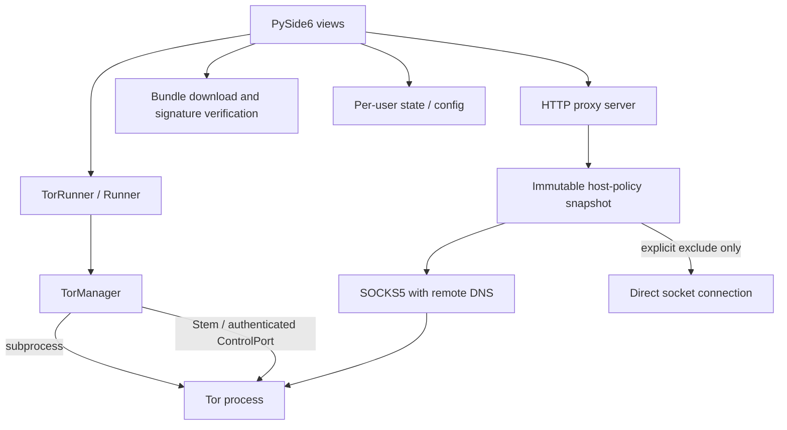

# Architecture

## Components

## Process lifecycle

`TorManager` owns only the subprocess it creates. It validates the executable and generated torrc, uses Tor's configuration verification mode before launch, redirects child output to a file rather than leaving pipes undrained, and polls the process while waiting for the authenticated ControlPort and bootstrap status. Startup has a deadline. Shutdown requests termination of the managed child, waits a bounded interval, then force-terminates if required.

States are `STOPPED`, `STARTING`, `BOOTSTRAPPING`, `READY`, `STOPPING`, and `FAILED`. `READY` means Tor reported a completed bootstrap, the ControlPort responded after authentication, the control endpoint identified the managed PID, and the SOCKS TCP listener accepted a connection. It does not mean every destination is reachable; the proxied IP check tests a real request separately.

The HTTP proxy is an independent local service. It is loopback-only. HTTP absolute-form requests and HTTPS CONNECT share one hostname policy. Normal traffic goes through the configured SOCKS endpoint with remote DNS; excluded hosts take an explicit direct route. Blocked hosts are rejected before upstream connection attempts.

## Thread boundaries

- Qt widgets are created and updated on the GUI thread.
- `TorRunner` runs blocking supervisor work on a dedicated Python thread and emits Qt signals for logs and failures.
- HTTP requests run in handler threads.
- HTTP request handlers run in threads because proxy work is predominantly socket I/O; the local listener and its lifecycle remain in a dedicated background thread.
- The traffic tracker drains a bounded, non-blocking byte-event queue and persists totals plus minute-level upload/download history to a per-user SQLite database on its own background thread. It never writes to disk from a socket handler; old minute buckets are pruned after 180 days.
- Network requests and bundle installation run in UI worker tasks; results/errors return through worker signals.

Avoid calling widgets directly from a worker. Status and log updates should be delivered to Qt slots through signals. Some old UI helpers remain transitional and need the same review as the rest of the UI migration.

## Desktop shell and bundle workflow

The current Qt shell retains the existing service-facing widgets and top navigation, adds a consistent page heading, puts the global service-state label in the page header, and applies theme-aware surfaces. The overview remains the place for connect/disconnect, traffic counters, exit-IP checking, system-proxy opt-in and event logs; the configuration page retains ports, bridge records and QR input; host rules and the bundle manager have separate navigation entries. This is an incremental presentation migration, not a claim that every legacy view has moved into a fully separated view-model package.

The bundle manager performs release-directory discovery separately from artifact eligibility. It recognizes the stable `X.Y.Z` and currently supported alpha `X.YaN`/ `X.Y.ZaN` forms, orders stable releases before prereleases, and checks for the exact platform/architecture archive plus a detached signature when OpenPGP is enabled. `BundleProgress` is an immutable event model propagated through the download callback and a Qt signal; widget updates remain in a GUI-thread slot. A missing total transfer length uses indeterminate progress, and the bar does not claim installation success before extraction and installation finish.

OpenPGP publisher-signature verification is optional and off by default in Settings → Advanced. When enabled, TorProxy requires the detached signature, checks the full pinned Tor signing-key fingerprint, probes GnuPG before transferring the large archive, and fails closed if verification cannot run. When disabled, the archive is restricted to approved HTTPS hosts and safe extraction still applies, but publisher identity is not authenticated. Installation markers explicitly distinguish `openpgp` from `https_only`; the project does not bundle GnuPG or provide GnuPG-independent OpenPGP verification.

## Persistence and resources

- App configuration is stored in per-user configuration directories.
- Runtime state, logs, and downloaded bundles are stored in per-user writable paths.
- Packaged UI assets remain read-only resources.
- JSON settings and host-rule files use temporary files and atomic replacement.
- A downloaded Tor bundle is considered a managed/verified installation only when its detached signature is valid, archive digest is recorded, and verification marker is written in an isolated staging directory before the directory is atomically published at its final name.

## Identity workflow

A manual identity request checks Stem's `get_newnym_wait()`. When Tor reports a cooldown, the UI declines the request and logs the wait; otherwise it sends `NEWNYM`. Neither signal acceptance nor a completed request guarantees an exit-IP change. Existing connections may remain on their current circuits.
